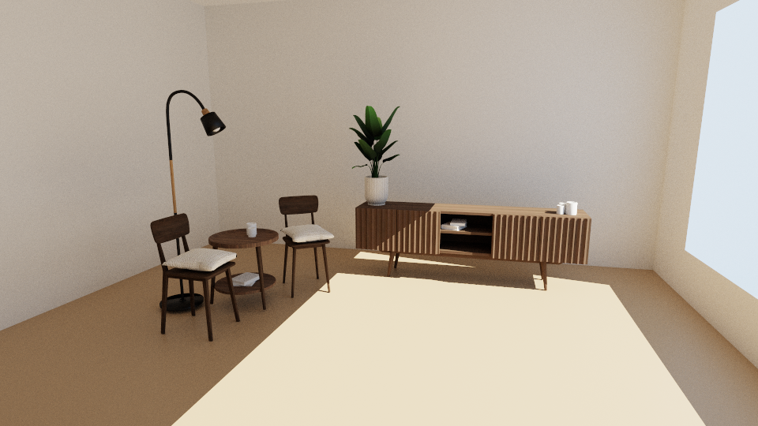
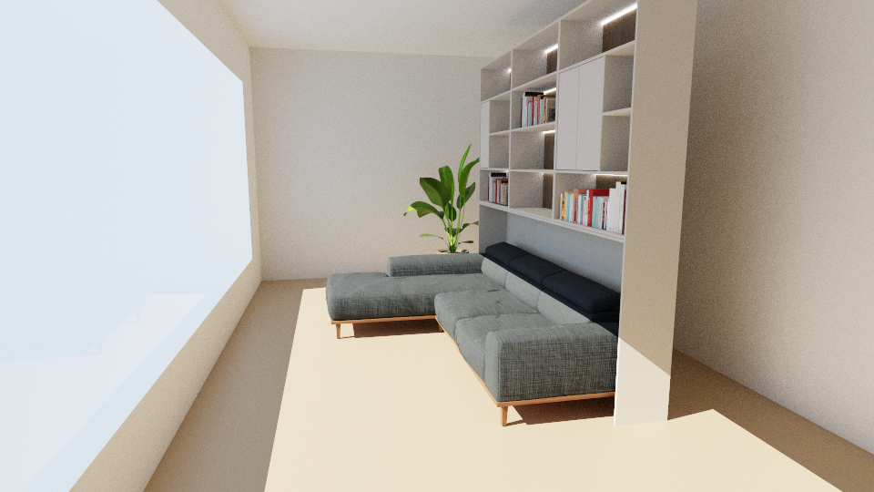
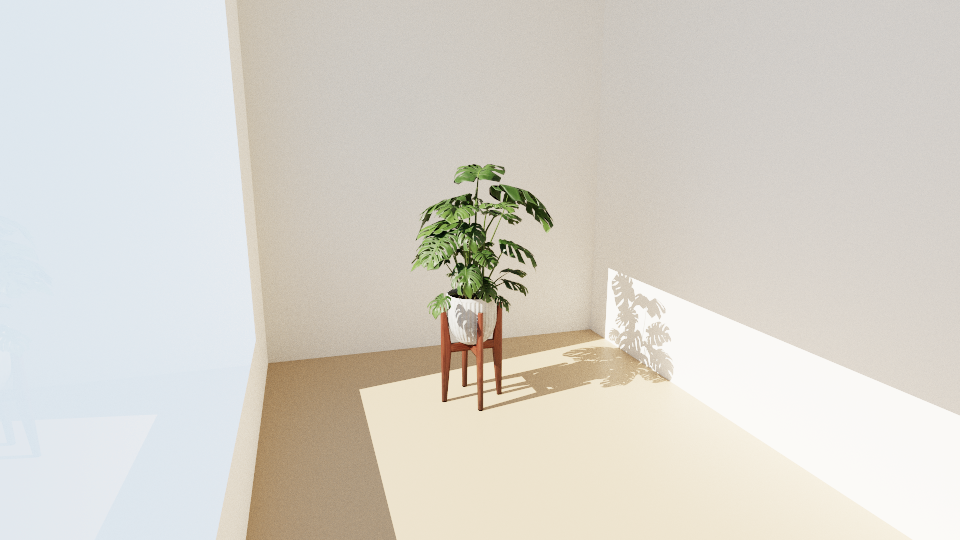
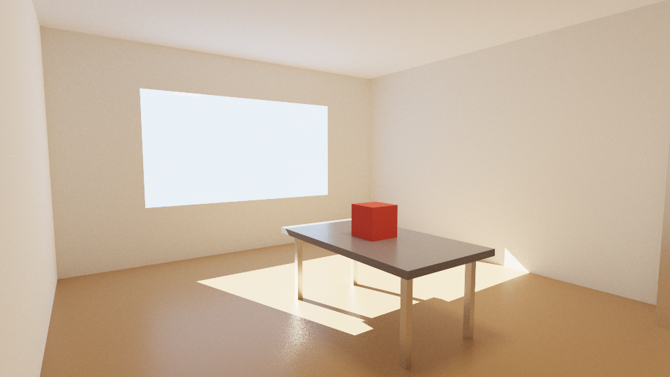
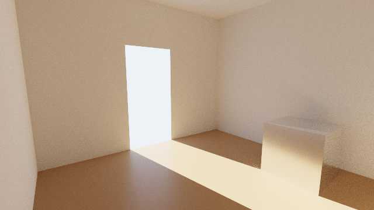
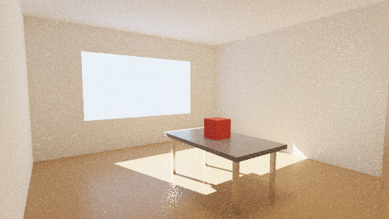
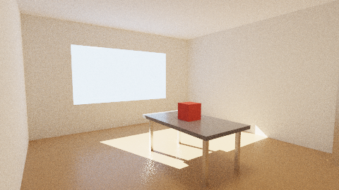

# SORT-rs

[](LICENSE)
[](https://www.rust-lang.org/)

A path tracer for architectural rendering, in pure Rust. It is a port of
[SORT](https://github.com/JiayinCao/SORT) (Simple Open-source Ray Tracing, by Jiayin Cao), with
the lighting reworked for interiors.

[Português (Brasil)](README.pt-BR.md)



A glTF model placed in a room with a glazed window, lit by the sun and the sky; 300 samples per
pixel. Furniture by Korusss ([credits](#models)).

| | |
|---|---|
|  |  |
| Sofa and bookcase by uniboxtrade: 124 thousand triangles, the strips of light in the shelves are emissive surfaces | Monstera by Giora |

## Status

Early. The renderer is tested against analytic results, on its built-in scenes and on the glTF
models shown here (up to 124 thousand triangles); it has not been run on a whole building yet.
See [what is not ported](#not-ported-yet).

## Running it

```sh
cargo build --release

cargo run --release -- --demo -o demo.png                 # the built-in interior
cargo run --release -- house.glb -o house.png -w 1920 --spp 512 --depth 8
cargo run --release -- house.glb --env sky.hdr --env-rotate 90      # lit by an HDR environment
cargo run --release -- house.glb --sun 135,40 --sky 1.2,1.6,2.2     # a sun (azimuth, elevation) and a plain sky
cargo run --release -- house.glb -o house.exr             # linear radiance
cargo run --release -- house.glb --projection ortho --ortho-height 8   # orthographic view 8 m high
cargo run --release -- house.glb --projection panorama -w 4096         # 360 degree panorama, 4096x2048
cargo run --release -- house.glb --integrator ao --ao-distance 2       # white clay render, ambient occlusion
cargo run --release -- --help
```

Scenes are glTF 2.0 (`.gltf` or `.glb`): meshes, metallic-roughness materials with their
textures, alpha modes (mask and blend), `KHR_texture_transform`, clearcoat
(`KHR_materials_clearcoat`) and sheen (`KHR_materials_sheen`), cameras and the lights of
`KHR_lights_punctual`. Lengths are in meters and Y is up. A file that lists clearcoat or sheen
in `extensionsRequired` (not only in `extensionsUsed`) is refused by the `gltf` crate, which
only accepts the required extensions it has types for.
`.png` and `.jpg` images are tone mapped (ACES by default) and sRGB encoded; `.exr` and `.hdr`
hold linear radiance.



The built-in interior, `--demo`, at 320 samples per pixel.

## As a library

The scene can be built in code, with no file involved
([`examples/library.rs`](examples/library.rs)):

```rust
let mut builder = SceneBuilder::new();
let plaster = builder.add_material(Material { base_color: Vec3::new(0.8, 0.78, 0.74), roughness: 0.9, ..Default::default() });
builder.add_quad([/* four corners, counter-clockwise */], plaster);
// ... the rest of the room, with a doorway in one wall ...

// where daylight comes in
builder.add_portal([/* the four corners of the doorway */]);

builder.add_light(Light::Distant { dir: -to_sun, intensity: Vec3::new(20.0, 18.0, 15.0) });
builder.add_light(Light::Sky(Sky { intensity: Vec3::new(1.2, 1.6, 2.2), env: None, rotation: 0.0 }));

let scene = builder.build();
let camera = Camera::look_at(eye, target, Vec3::Y, 60f32.to_radians(), 640, 360);
let pixels = render(&scene, &camera, &RenderSettings::default(), |_fraction_done| {});
save_image(Path::new("room.png"), &pixels, camera.width, camera.height, 1.0, ToneMap::Aces)?;
```



`cargo run --release --example library` renders this image.

[`examples/materials.rs`](examples/materials.rs) shows the coat, the sheen and the two cloths
(`Material::coat`, `sheen_color`, `cloth`) on a row of spheres over a varnished floor:
`cargo run --release --example materials`. A material can also have a different material on
its back face, `Material::back_material`, for sheets with two finishes; glTF has no way of
saying that.

The image at the top comes from [`examples/furnished.rs`](examples/furnished.rs), which loads a
glTF file into a `SceneBuilder` and adds the room, the window and the lights around it:

```sh
cargo run --release --example furnished -- assets/models/furniture_set.glb furnished.png 300 1.7 -x
cargo run --release --example furnished -- assets/models/p0140_04.glb living-room.png 300 2.4
cargo run --release --example furnished -- assets/models/monstera_deliciosa.glb monstera.png 300 1.3
```

The numbers are the samples per pixel and the height of the model in meters; `-x` puts the camera
on the other side of the model.

## Lighting an interior

A path tracer finds the light of an interior by chance: most of the sky is behind walls, the sun
reaches a patch of floor, and that patch lights everything else. The integrator departs from
SORT where that makes noise:

- **A shadow ray per kind of light** (each sun, the sky, the punctual lights, the emissive
  surfaces), not one light picked by its power. Among lamps, and among punctual lights, the one
  that contributes most at the shaded point is favored (resampled importance sampling).
- **Portals.** The sky is sampled through the openings. Thin glass is a portal by itself; an
  opening with no glass is marked with `SceneBuilder::add_portal` or, in a glTF file, with a
  material whose name starts with `portal` (its geometry is not rendered).
- **Sun points.** Each path is given a point lit by the sun through a portal and connects its
  vertices to it, which finds the sunlight bounced off the floor.
- **The ray that continues a path also looks for the lights**, weighted against light sampling,
  where SORT traces a second ray per vertex for that.
- **Blur after a rough bounce** (`--filter-glossy`, 0.5 by default). A polished surface seen
  after a matte bounce is made at least as blurry as that bounce was, so the caustics it would
  cast become soft light, not isolated bright pixels. This is the one change that is not exact:
  it darkens the built-in scene by 2.6%. `--filter-glossy 0` turns it off.

| `--filter-glossy 0`: exact caustics | default |
|---|---|
|  |  |

Both at 48 samples per pixel. Portals and sun points only change how light is sampled, not the
result, which a test checks.

On the built-in scene (320x180, depth 8) and for the same render time, the mean relative squared
error against a reference fell from 0.041 to 0.0057, compared with the first version of this
port, which sampled the lights the way SORT does. The tools of that
measurement are in `examples/`: `compare` (error against a reference image) and `variance`
(variance of each pixel, one kind of light at a time).

## What is ported

| SORT (C++) | SORT-rs | Notes |
|---|---|---|
| `integrator/pathtracing`, `integratormethod` | `integrator.rs` | Path tracing, light sampling with multiple importance sampling, Russian roulette; see above |
| `integrator/ao` | `integrator.rs` | Ambient occlusion for white "clay" renders; thin glass attenuates instead of blocking |
| `accel/bvh`, `bvh_utils` | `bvh.rs` | SAH with 16 bins; the tree is a flat array, traversed without recursion |
| `shape/triangle` | `scene.rs` | Watertight intersection |
| `camera/perspective`, `orthogonal`, `environment` | `camera.rs` | Perspective with depth of field, orthographic, 360 degree latitude-longitude panorama |
| `bsdf/disney`, `microfacet`, `fresnel`, `lambert`, `transparent` | `bsdf.rs` | The Disney BRDF without sub-surface scattering; anisotropic GGX |
| `bsdf/coat` | `bsdf.rs`, `material.rs` | A varnish or lacquer layer; the base under it is the Disney BRDF. `Material::coat`, glTF clearcoat |
| `bsdf/fabric`, `distributionbrdf` | `bsdf.rs`, `material.rs` | The DreamWorks fabric and the distribution-based cloth of The Order: 1886, as `Material::cloth`; the second is also the glTF sheen |
| `bsdf/doublesided` | `scene.rs`, `material.rs` | A back material, `Material::back_material`, shades the back face |
| `scatteringevent` | `bsdf.rs` | A mix of BXDFs with evaluation and sampling weights |
| `light/distant`, `pointlight`, `spot`, `skylight`, `hdrskylight`, `area` | `light.rs` | An area light is a set of emissive triangles |
| `material` and the Tiny Shading Language | `material.rs` | No shading language: a fixed set of parameters becomes the closures |
| The binary format of the Blender exporter | `gltf_loader.rs` | glTF 2.0 |

## Other differences from SORT

- **Thin glass** (transmission with no `KHR_materials_volume`): light goes straight through, the
  pane reflects as a dielectric, and shadow rays cross it attenuated. That is what lets the sun
  into a room through a window.
- **Alpha.** A masked material (leaves, fences, perforated screens) is a hole in the geometry
  where its alpha is below the cutoff: rays of every kind go through. A blended one (sheer
  curtains) is partial coverage: the surface is there with a probability equal to its alpha,
  light goes straight through the rest, and shadow rays cross it attenuated by that fraction.
- Shadow rays start 0.1 mm from the surface, not 1 cm: at 1 cm, light leaks along every corner
  of a room modelled in meters.
- The BVH may be 48 levels deep, not 16, for scenes of millions of triangles.
- Consistency fixes: rough refraction is zero for directions its own sampling cannot produce,
  the pdf of the diffuse lobe of the Disney BRDF covers one hemisphere only, and the mix of
  BXDFs is evaluated in one frame. They are commented in the code.
- **Coat and fabric.** The light the top of the layer reflects back down is returned to the base, which
  keeps a white base under a clear coat white (SORT loses about 30% of it), and the base is
  weighted with the cosine outside the layer, not inside. The color of the coat is the
  transmittance of a straight trip down and up, not the curve SORT's Blender node uses. The
  fabric is normalized with the exact albedo of its lobe; SORT's table makes it 7 to 21% darker.

## Not ported yet

Participating media, sub-surface scattering, hair and fur, the MERL and Fourier BRDFs, the
other integrators (bidirectional, light tracing, instant radiosity, Whitted), the other
accelerators (QBVH, OBVH, k-d tree, octree, uniform grid) and SIMD. A coat over anything but
the Disney BRDF. On the glTF side: texture coordinate sets other than `TEXCOORD_0`, the normal
map of the clearcoat, and `KHR_texture_transform` on normal textures (the `gltf` crate does not
expose it there, so a transformed normal map is applied with the mesh UVs as they are).

## Tests

`cargo test` runs 41 tests: importance sampling against value and pdf for every BXDF, the BVH
against a brute force loop, the camera, the environment map, the glTF loader, materials and
their textures, and renders compared with analytic results.

## Models

The models in the images are in [`assets/models`](assets/models). They are not part of SORT-rs
and keep their own licenses:

| Model | Author | License | File |
|---|---|---|---|
| Furniture set | Korusss | Creative Commons Attribution | `furniture_set.glb` |
| Sofa and bookcase | uniboxtrade | Creative Commons | `p0140_04.glb` |
| Monstera deliciosa | Giora | Creative Commons | `monstera_deliciosa.glb` |

## License

SORT-rs is a derived work of SORT, which is Copyright (c) 2011-2023 Jiayin Cao and distributed
under the GNU General Public License version 3. SORT-rs is distributed under the same license,
[GPL-3.0-only](LICENSE).
