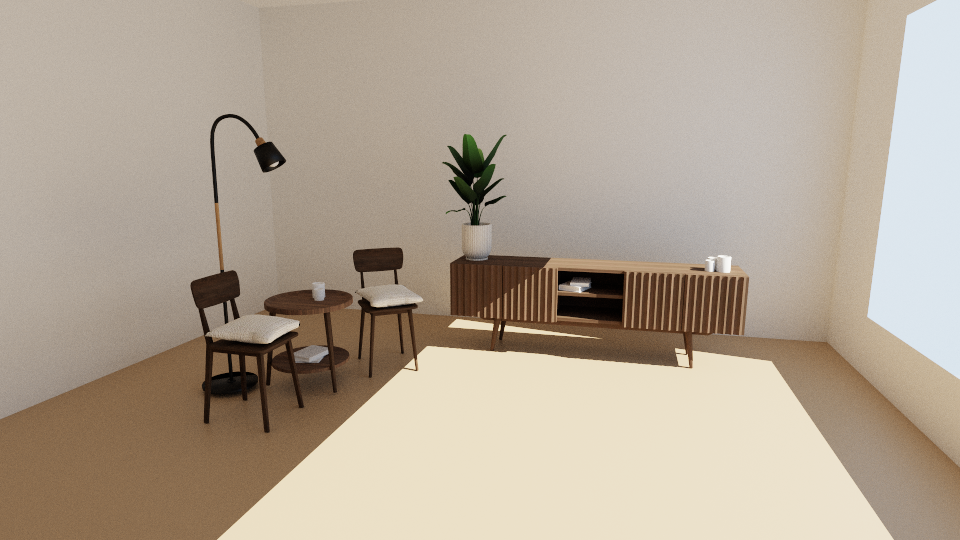
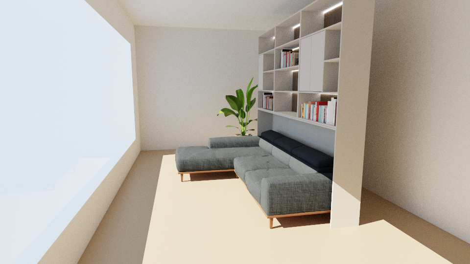
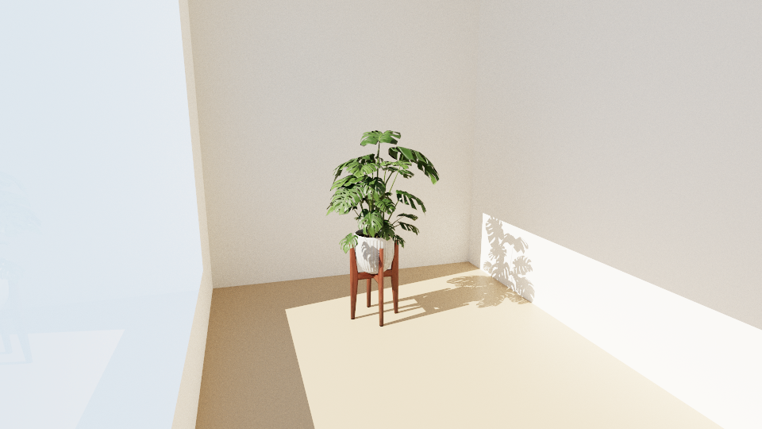
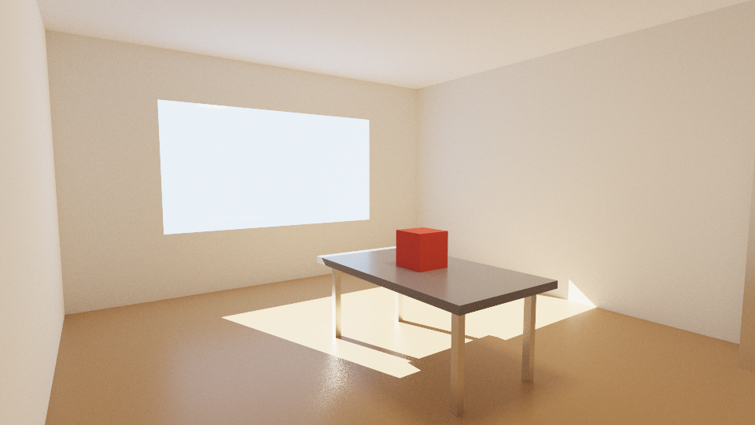
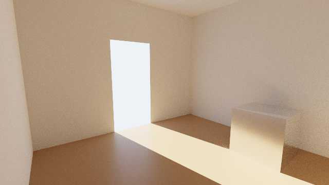
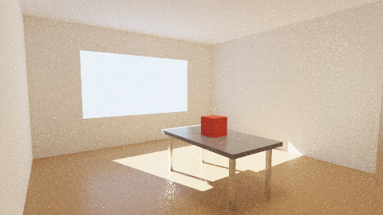
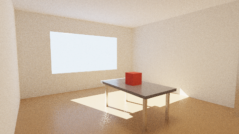

# SORT-RayTracing

[](LICENSE)
[](https://www.rust-lang.org/)

Um path tracer para render arquitetônico, em Rust puro. É um port do
[SORT](https://github.com/JiayinCao/SORT) (Simple Open-source Ray Tracing, de Jiayin Cao), com a
iluminação refeita para interiores.

[English](README.md)



Um modelo glTF colocado em uma sala com janela envidraçada, iluminado pelo sol e pelo céu; 300
amostras por pixel. Móveis de Korusss ([créditos](#modelos)).

| | |
|---|---|
|  |  |
| Sofá e estante de uniboxtrade: 124 mil triângulos, as fitas de luz nas prateleiras são superfícies emissivas | Monstera de Giora |

## Estado

Inicial. O renderizador é testado contra resultados analíticos, nas suas cenas embutidas e nos
modelos glTF mostrados aqui (até 124 mil triângulos); ainda não foi usado em um edifício inteiro.
Veja [o que não foi portado](#ainda-não-portado).

## Como rodar

```sh
cargo build --release

cargo run --release -- --demo -o demo.png                 # o interior embutido
cargo run --release -- casa.glb -o casa.png -w 1920 --spp 512 --depth 8
cargo run --release -- casa.glb --env ceu.hdr --env-rotate 90       # iluminada por um ambiente HDR
cargo run --release -- casa.glb --sun 135,40 --sky 1.2,1.6,2.2      # um sol (azimute, elevação) e um céu liso
cargo run --release -- casa.glb --eye 14,1.7,26 --target 0,4.5,0      # posiciona a câmera, em metros
cargo run --release -- casa.glb -o casa.exr               # radiância linear
cargo run --release -- casa.glb --projection ortho --ortho-height 8    # vista ortográfica de 8 m de altura
cargo run --release -- casa.glb --projection panorama -w 4096          # panorama de 360 graus, 4096x2048
cargo run --release -- casa.glb --integrator ao --ao-distance 2        # render branco de maquete, ambient occlusion
cargo run --release -- casa.glb --fog 0.06 --fog-anisotropy 0.6        # poeira no ar de uma sala
cargo run --release -- casa.glb --fog 0.008 --fog-height 30            # uma camada de névoa sobre um terreno
cargo run --release -- --help
```

As cenas são glTF 2.0 (`.gltf` ou `.glb`): malhas, materiais metallic-roughness com suas
texturas, modos de alpha (mask e blend), `KHR_texture_transform`, clearcoat
(`KHR_materials_clearcoat`) e sheen (`KHR_materials_sheen`), câmeras e as luzes de
`KHR_lights_punctual`. Materiais do fluxo antigo specular-glossiness
(`KHR_materials_pbrSpecularGlossiness`) são convertidos de forma aproximada. Comprimentos em
metros, Y para cima. Mapas de ambiente com mais de 8192 pixels de largura são reduzidos pela
média ao carregar. Um arquivo que lista clearcoat ou
sheen em `extensionsRequired` (e não só em `extensionsUsed`) é recusado pelo crate `gltf`, que só
aceita as extensões obrigatórias para as quais tem tipos.
Imagens `.png` e `.jpg` recebem tone mapping (ACES por padrão) e sRGB; `.exr` e `.hdr` guardam
radiância linear.



O interior embutido, `--demo`, com 320 amostras por pixel.

## Como biblioteca

A cena pode ser montada em código, sem arquivo nenhum
([`examples/library.rs`](examples/library.rs)):

```rust
let mut builder = SceneBuilder::new();
let plaster = builder.add_material(Material { base_color: Vec3::new(0.8, 0.78, 0.74), roughness: 0.9, ..Default::default() });
builder.add_quad([/* quatro cantos, em sentido anti-horário */], plaster);
// ... o resto da sala, com um vão de porta em uma parede ...

// por onde a luz do dia entra
builder.add_portal([/* os quatro cantos do vão */]);

builder.add_light(Light::Distant { dir: -to_sun, intensity: Vec3::new(20.0, 18.0, 15.0) });
builder.add_light(Light::Sky(Sky { intensity: Vec3::new(1.2, 1.6, 2.2), env: None, rotation: 0.0 }));

let scene = builder.build();
let camera = Camera::look_at(eye, target, Vec3::Y, 60f32.to_radians(), 640, 360);
let pixels = render(&scene, &camera, &RenderSettings::default(), |_fraction_done| {});
save_image(Path::new("room.png"), &pixels, camera.width, camera.height, 1.0, ToneMap::Aces)?;
```



`cargo run --release --example library` gera esta imagem.

Uma aplicação que mostra a imagem enquanto ela é renderizada usa `Progressive` no lugar de
`render` ([`examples/progressive.rs`](examples/progressive.rs)). Cada passo soma uma amostra a
todos os pixels, a imagem parcial pode ser lida entre dois passos, e descartar o objeto
abandona o render:

```rust
let mut render = Progressive::new(&scene, &camera, &settings);
while render.step() {
    show(&render.image(), render.samples(), render.total_samples());
    if camera_moved() { break; }
}
```

`Progressive::with_region` renderiza só um retângulo da imagem, em pixels a partir do canto
superior esquerdo, e nunca traça o resto:

```rust
let region = Region { x: 220, y: 120, width: 200, height: 120 };
let mut render = Progressive::with_region(&scene, &camera, &settings, region);
```

[`examples/materials.rs`](examples/materials.rs) mostra o coat, o sheen e os dois tecidos
(`Material::coat`, `sheen_color`, `cloth`) em uma fileira de esferas sobre um piso envernizado:
`cargo run --release --example materials`. Um material também pode ter outro material na face
de trás, `Material::back_material`, para lâminas com dois acabamentos; o glTF não tem como
dizer isso.

A imagem do topo vem de [`examples/furnished.rs`](examples/furnished.rs), que carrega um arquivo
glTF em um `SceneBuilder` e acrescenta a sala, a janela e as luzes em volta dele:

```sh
cargo run --release --example furnished -- assets/models/furniture_set.glb furnished.png 300 1.7 -x
cargo run --release --example furnished -- assets/models/p0140_04.glb living-room.png 300 2.4
cargo run --release --example furnished -- assets/models/monstera_deliciosa.glb monstera.png 300 1.3
```

Os números são as amostras por pixel e a altura do modelo em metros; `-x` põe a câmera do outro
lado do modelo.

## Iluminação de interiores

Um path tracer encontra a luz de um interior por acaso: a maior parte do céu está atrás de
paredes, o sol chega a um trecho do piso, e esse trecho ilumina todo o resto. O integrador se
afasta do SORT nos pontos em que isso gera ruído:

- **Um raio de sombra por tipo de luz** (cada sol, o céu, as luzes pontuais, as superfícies
  emissivas), e não uma luz sorteada pela potência. Entre luminárias, e entre luzes pontuais, a
  que mais contribui no ponto é favorecida (resampled importance sampling).
- **Portais.** O céu é amostrado através das aberturas. Vidro fino já é portal; uma abertura
  sem vidro se marca com `SceneBuilder::add_portal` ou, em um arquivo glTF, com um material cujo
  nome começa com `portal` (a geometria dele não é renderizada).
- **Pontos de sol.** Cada caminho recebe um ponto iluminado pelo sol através de um portal e
  conecta seus vértices a ele, o que encontra a luz do sol rebatida no piso.
- **O raio que continua o caminho também procura as luzes**, ponderado contra a amostragem de
  luz; o SORT traça um segundo raio por vértice para isso.
- **Desfoque depois de um rebote difuso** (`--filter-glossy`, 0,5 por padrão). Uma superfície
  polida vista depois de um rebote fosco fica pelo menos tão borrada quanto esse rebote, e as
  cáusticas que ela lançaria viram luz suave em vez de pixels brilhantes isolados. É a única
  mudança não exata: escurece a cena embutida em 2,6%. `--filter-glossy 0` desliga.

| `--filter-glossy 0`: cáusticas exatas | padrão |
|---|---|
|  |  |

As duas com 48 amostras por pixel. Portais e pontos de sol só mudam como a luz é amostrada, não
o resultado, o que um teste confere.

Na cena embutida (320x180, profundidade 8) e com o mesmo tempo de render, o erro quadrático
relativo médio contra uma referência caiu de 0,041 para 0,0057, em comparação com a primeira
versão deste port, que amostrava as luzes como o SORT.
As ferramentas dessa medição estão em `examples/`: `compare` (erro contra uma imagem de
referência) e `variance` (variância de cada pixel, um tipo de luz por vez).

## O que foi portado

| SORT (C++) | SORT-rs | Observações |
|---|---|---|
| `integrator/pathtracing`, `integratormethod` | `integrator.rs` | Path tracing, amostragem de luz com multiple importance sampling, roleta russa; veja acima |
| `integrator/ao` | `integrator.rs` | Ambient occlusion para renders brancos de "maquete"; vidro fino atenua em vez de bloquear |
| `accel/bvh`, `bvh_utils` | `bvh.rs` | SAH com 16 bins; a árvore é um array, percorrido sem recursão |
| `shape/triangle` | `scene.rs` | Interseção watertight |
| `camera/perspective`, `orthogonal`, `environment` | `camera.rs` | Perspectiva com profundidade de campo, ortográfica, panorama de 360 graus em latitude-longitude |
| `bsdf/disney`, `microfacet`, `fresnel`, `lambert`, `transparent` | `bsdf.rs` | O Disney BRDF sem sub-surface scattering; GGX anisotrópico |
| `bsdf/coat` | `bsdf.rs`, `material.rs` | Uma camada de verniz ou laca; a base sob ela é o Disney BRDF. `Material::coat`, clearcoat do glTF |
| `bsdf/fabric`, `distributionbrdf` | `bsdf.rs`, `material.rs` | O tecido da DreamWorks e o tecido baseado em distribuição de The Order: 1886, como `Material::cloth`; o segundo também é o sheen do glTF |
| `bsdf/doublesided` | `scene.rs`, `material.rs` | Um material de trás, `Material::back_material`, sombreia a face de trás |
| `medium/absorption`, `homogeneous`, `phasefunction` | `medium.rs`, `integrator.rs` | Neblina e névoa em uma caixa ou camada (`--fog`) e o interior de vidro maciço ou água (`Material::medium`, atenuação do `KHR_materials_volume` do glTF); função de fase de Henyey-Greenstein |
| `scatteringevent` | `bsdf.rs` | Uma mistura de BXDFs com pesos de avaliação e de amostragem |
| `light/distant`, `pointlight`, `spot`, `skylight`, `hdrskylight`, `area` | `light.rs` | Uma luz de área é um conjunto de triângulos emissivos |
| `material` e a Tiny Shading Language | `material.rs` | Sem linguagem de shading: um conjunto fixo de parâmetros vira as closures |
| O formato binário do exportador do Blender | `gltf_loader.rs` | glTF 2.0 |

## Outras diferenças em relação ao SORT

- **Vidro fino** (transmissão sem `KHR_materials_volume`): a luz atravessa em linha reta, a
  lâmina reflete como um dielétrico e os raios de sombra a cruzam atenuados. É o que deixa o sol
  entrar em uma sala por uma janela.
- **Alpha.** Um material com máscara (folhas, cercas, chapas perfuradas) é um furo na geometria
  onde o alpha fica abaixo do corte: raios de todo tipo passam. Um material com blend (cortinas
  translúcidas) é cobertura parcial: a superfície está lá com probabilidade igual ao alpha, a luz
  atravessa o resto em linha reta e os raios de sombra a cruzam atenuados nessa fração.
- Os raios de sombra partem a 0,1 mm da superfície, não a 1 cm: com 1 cm, a luz vaza em todos os
  cantos de um ambiente modelado em metros.
- A BVH pode ter 48 níveis, não 16, para cenas com milhões de triângulos.
- Correções de consistência: a refração rugosa é zero nas direções que a própria amostragem não
  produz, o pdf do lobo difuso do Disney BRDF cobre só um hemisfério, e a mistura de BXDFs é
  avaliada em um único referencial. Estão comentadas no código.
- **Coat e tecido.** A luz que o topo da camada reflete de volta para baixo é devolvida à base,
  o que mantém branca uma base branca sob um coat transparente (o SORT perde cerca de 30% dela),
  e a base é ponderada pelo cosseno de fora da camada, não de dentro. A cor do coat é a
  transmitância de uma ida e volta em linha reta, não a curva que o nó do Blender do SORT usa. O
  tecido é normalizado com o albedo exato do seu lobo; a tabela do SORT o deixa de 7 a 21% mais
  escuro.

- **Meios participantes.** O SORT prende um meio a qualquer malha e mantém uma pilha dos meios
  em que o raio está. Aqui um meio é neblina preenchendo uma caixa (os limites da cena, ou uma
  camada abaixo de uma altura que se estende sem fim para os lados) ou o interior de um objeto
  transmissivo maciço. Uma caixa dispensa malha de contorno e funciona onde quer que a câmera
  esteja. A absorção não é amostrada, é um fator simples; os vértices de um caminho dentro de
  um meio são iluminados como os das superfícies, com a mesma amostragem de luz.

## Ainda não portado

O meio heterogêneo (precisa de dados de volume), meios presos a malhas quaisquer, emissão
dentro de um meio, sub-surface scattering, cabelo e pelo, os BRDFs MERL e Fourier, os outros
integradores (bidirecional, light tracing, instant radiosity, Whitted), os outros aceleradores
(QBVH, OBVH, k-d tree, octree, grade uniforme) e SIMD. Um coat sobre outra coisa que não o
Disney BRDF. Do lado do glTF: conjuntos de coordenadas de textura além de `TEXCOORD_0`, o normal
map do clearcoat e `KHR_texture_transform` em texturas de normal (o crate `gltf` não o expõe
ali, então um normal map transformado é aplicado com as UVs da malha como estão).

## Testes

`cargo test` roda 48 testes: amostragem por importância contra valor e pdf de cada BXDF, a BVH
contra um laço de força bruta, a câmera, o mapa de ambiente, o loader de glTF, materiais e suas
texturas, meios participantes e renders comparados com resultados analíticos.

## Modelos

Os modelos das imagens estão em [`assets/models`](assets/models). Eles não fazem parte do
SORT-rs e mantêm suas próprias licenças:

| Modelo | Autor | Licença | Arquivo |
|---|---|---|---|
| Conjunto de móveis | Korusss | Creative Commons Attribution | `furniture_set.glb` |
| Sofá e estante | uniboxtrade | Creative Commons | `p0140_04.glb` |
| Monstera deliciosa | Giora | Creative Commons | `monstera_deliciosa.glb` |

## Licença

O SORT-RayTracing é uma obra derivada do SORT, que é Copyright (c) 2011-2023 Jiayin Cao e distribuído
sob a GNU General Public License versão 3. O SORT-rs é distribuído sob a mesma licença,
[GPL-3.0-only](LICENSE).
